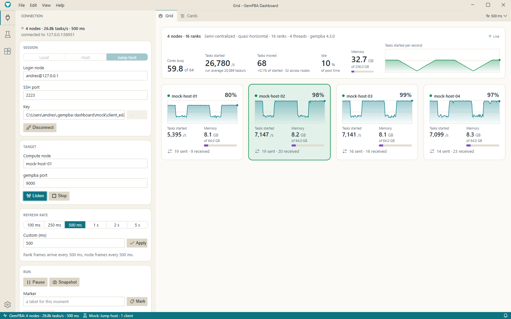

# GemPBA

**GemPBA** (Generic Massive Parallelisation of Branching Algorithms) parallelizes branch-and-bound, backtracking and other recursive search algorithms. Its core is **C++23**, for speed, and it is just as much a **Java** library: the same runtime is on Maven Central as `io.github.rapastranac:gempba`, and a C ABI opens it to other languages. It runs a search on:

- **Multithreading:** all the cores of one machine, with nothing else to install
- **MPI:** many processes across many nodes, over the Open MPI, MPICH or MS-MPI you already have
- **Hybrid:** several threads per process, spread across nodes

-   **C++**

    `find_package(gempba)`, plus `COMPONENTS mpi` for MPI, from APT, Homebrew or MSYS2.

    [Install for C++](getting-started/installation.md) · [Quick Start](quick-start.md)

-   **Java**

    `io.github.rapastranac:gempba` or `gempba-mpi` on Maven Central, no token, natives inside the JAR.

    [Install for Java](java/installation.md) · [Quick Start](java/quick-start.md)

## What's new in v5

-   **One core, one entry point**

    No more build-time flavors: one library with multithreading built in, and MPI as a component you ask for. Every rank calls `scheduler::run`, with the same API in C++ and Java.

    [Architecture](architecture.md)

-   **MPI your way**

    The MPI component compiles in your build against the MPI you have: Open MPI, MPICH or MS-MPI. Switching MPIs is a new build directory, not a reinstall.

    [Installation](getting-started/installation.md)

-   **Exact termination**

    A run ends exactly when its work is done: Dijkstra–Scholten acknowledgements, with no timeout and no heuristic. v5 drops the old timeout parameter for good.

    [How the run ends](scheduler-topologies.md#how-the-run-ends)

-   **Stop a run, know how it ended**

    Ctrl+C, `SIGTERM`, `request_stop()` or a dashboard wind a run down gracefully, keeping its best result, and every run says whether that result is proven.

    [Stopping a Run](stopping-a-run.md)

-   **Java on Maven Central**

    One dependency, no repository or token, with Linux, Windows and Apple Silicon natives inside the JAR, and your own native when you need another MPI.

    [Java](java/index.md)

-   **In MSYS2's own repository**

    On Windows, `pacman -S mingw-w64-ucrt-x86_64-gempba` installs GemPBA from MSYS2's UCRT64 repository, next to `apt` on Ubuntu and `brew` on macOS.

    [Installation](getting-started/installation.md#windows-msys2-ucrt64)

-   **A clean shared library**

    `libgempba.so.5` exports only its API, keeps its dependencies private, and its headers include only the standard library.

    [Releases](releases.md)

## The research behind it

Two research contributions are baked into the framework.

The first is the **Quasi-Horizontal Load Balancing** strategy. Standard work-stealing treats all pending tasks equally. Quasi-horizontal balancing understands the shape of your recursion tree and selects work near the root, where each task will spawn the most downstream work. For branching algorithms where subtree sizes vary dramatically, this makes a significant difference in CPU utilization.

The second is the **Semi-Centralized Scheduler**. Distributing work across processes sounds straightforward until you hit the rejected task problem: a worker receives a task, but by the time it arrives the worker is already busy and has to bounce it back to the sender. Do this naively and you spend more time rerouting work than doing it. The semi-centralized design avoids this by keeping a lightweight coordinator that never holds tasks itself but maintains global priority awareness. The coordinator always knows which worker is idle and routes tasks directly there, eliminating the bounce-back problem without becoming a bottleneck.

For the full performance analysis and formal description, see:

- [MSc. Thesis](http://hdl.handle.net/11143/18687)
- [Paper in Parallel Computing](https://doi.org/10.1016/j.parco.2023.103024)

!!! tip "Explore the internals"
    For a navigable, AI-assisted deep-dive into GemPBA's architecture and source, browse the **[GemPBA DeepWiki](https://deepwiki.com/rapastranac/gempba)** — auto-generated and refreshed periodically.

## GemPBA Dashboard

A desktop app that connects to a running GemPBA program and shows the whole run live: every node and rank, the cores working, the tasks moving between them, idle time and memory as they change.

<figure markdown="span">
  
</figure>

- See the whole run at a glance: a summary on top, one live tile per node below.
- Drill into any node, socket or rank for its CPU, tasks, idle time, memory and busiest peers.
- Connect locally, to a host over SSH, or straight to an HPC compute node through an MFA login node, with no manual tunnel.

[See the dashboard](telemetry/dashboard.md){ .md-button .md-button--primary }
[Download](https://github.com/rapastranac/gempba-dashboard/releases/latest){ .md-button }

## The core and the MPI component

GemPBA is one library with multithreading built in, plus an optional MPI component, on any platform:

- **The core** (`gempba`) — uses all cores of a single machine; no MPI needed.
- **The MPI component** (`gempba-mpi`) — distributes work across multiple machines/nodes over MPI. It installs as source, and your build compiles it against your MPI.

A program uses the MPI component only when it asks for it, so multithreading and MPI programs build side by side from one installation. See [Installation](getting-started/installation.md) for APT / MSYS2 / Homebrew instructions and `find_package(gempba COMPONENTS mpi)`, and [Architecture](architecture.md) for how the pieces fit.

!!! tip "Using Java?"
    The Java API is the same core from the JVM, as `gempba` and `gempba-mpi` on Maven Central. See the **[Java section](java/index.md)**.

## Platforms

Pre-built packages and the Java fat JAR target one architecture per OS; other architectures work via source build.

| OS | Architecture |
|---|---|
| Linux | `x86_64` |
| Windows | `x86_64` |
| macOS | `aarch64` (Apple Silicon) |

## Requirements

| Dependency | Version | Notes |
|---|---|---|
| C++ compiler | C++23 | GCC or Clang (AppleClang on macOS); on Windows, MSYS2 UCRT64's GCC |
| CMake | ≥ 3.28 | |
| hwloc | ≥ 2.10 | Hardware-topology probe (telemetry); needed at run time too |
| pkg-config | any recent | Finds hwloc in the build |
| MPI | Open MPI ≥ 4.0, MPICH, or MS-MPI | Only for the MPI component |
| spdlog / fmt | ≥ 1.12 / ≥ 9.1 | Build only; compiled into the library |
| Boost | any recent | Optional — tests only |
| GoogleTest | any recent | Optional — running tests only |

