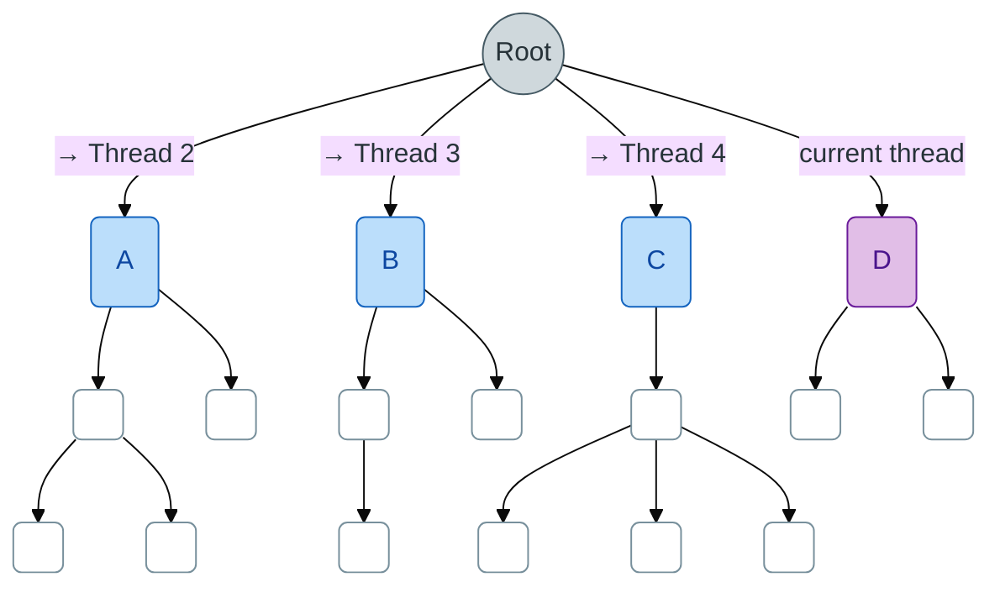
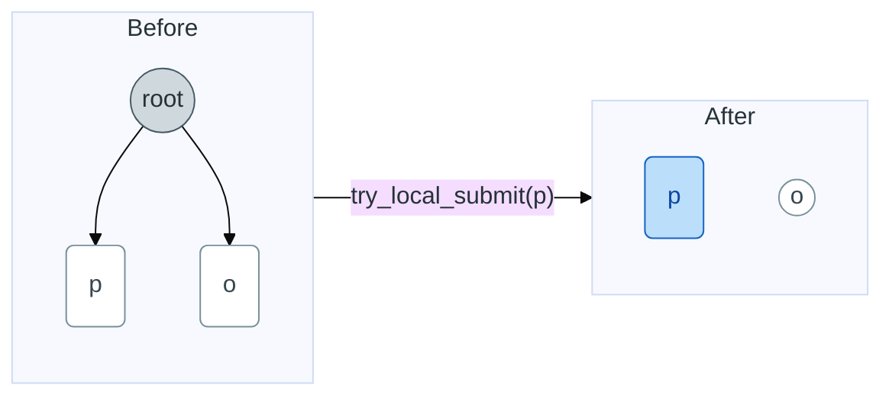
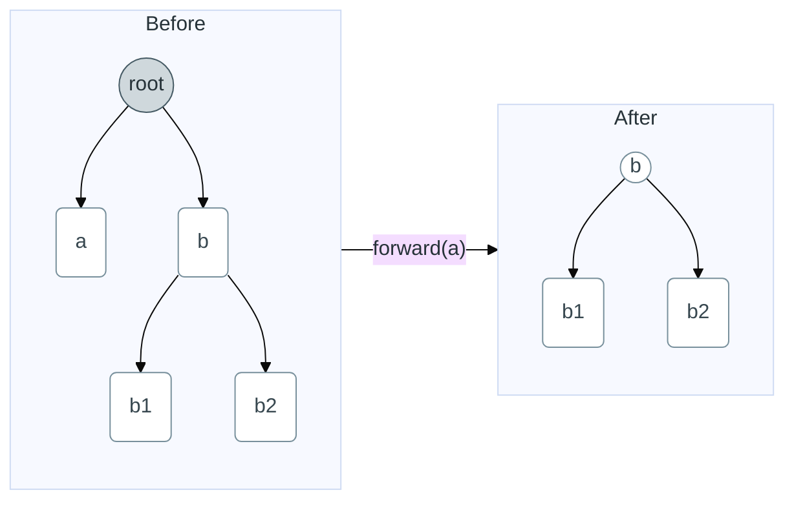
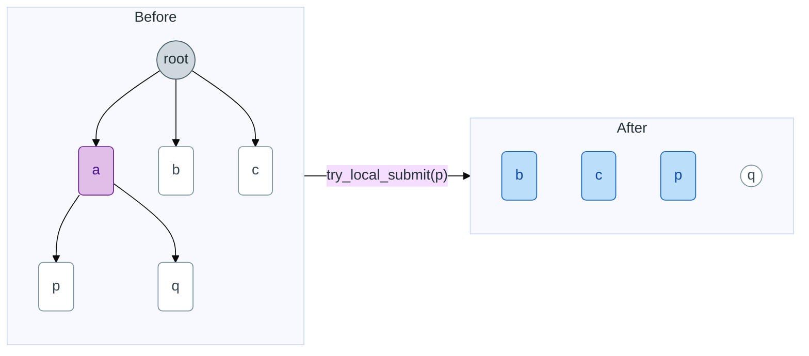
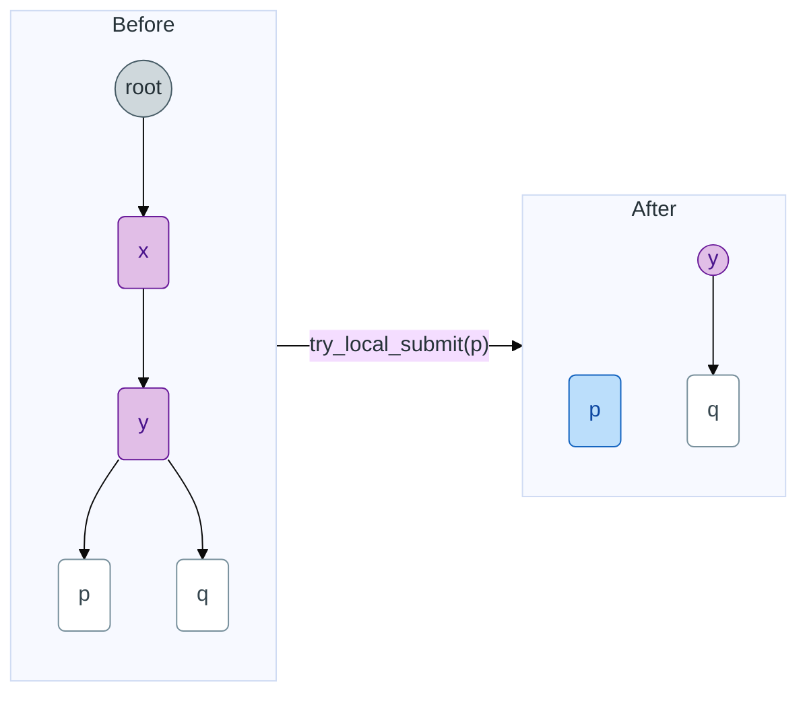
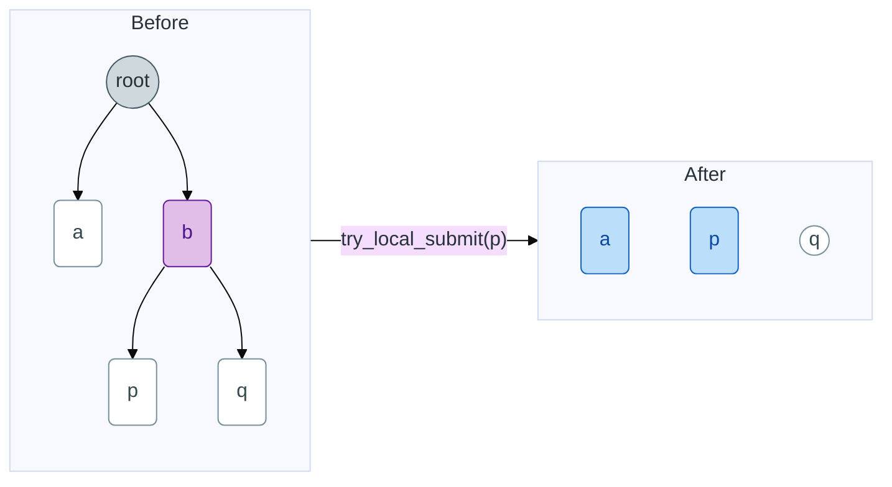
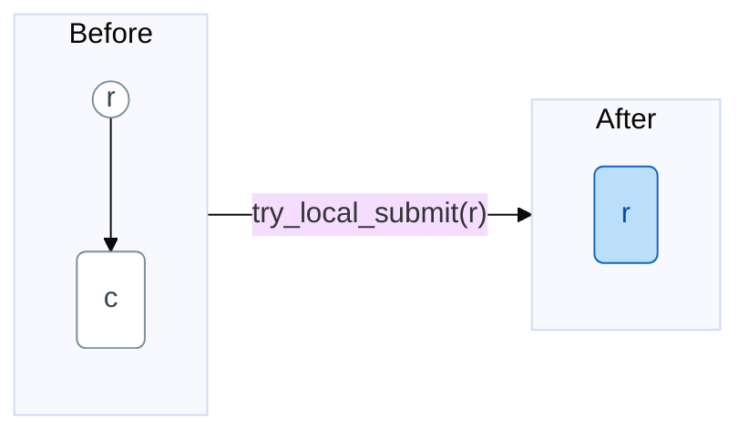

# Quasi-Horizontal

```cpp
auto* lb = gempba::multithreading::create_load_balancer(gempba::balancing_policy::QUASI_HORIZONTAL);
```

Implements [`load_balancer`](../../interfaces/load-balancer.md). The primary scheduling strategy of GemPBA and the main algorithmic contribution of the original research. Designed for branching algorithms where subtree sizes are unknown and highly unbalanced, which is the common case.

---

## The problem it solves

In a branch-and-bound search the recursion tree is highly unbalanced: one subtree might contain millions of nodes while its sibling contains three. Naive work-stealing picks whatever task is available, which is often a node near the leaves with almost no work left under it. Threads finish quickly and sit idle while one thread drowns in the large subtree.

Quasi-horizontal avoids this by handing out work **near the root first**. Nodes close to the root are the parents of the largest subtrees, so giving them to idle threads early gives each thread a roughly equal share of the work below.



The current thread keeps exploring <span style="background:#e1bee7;color:#4a148c;border:1px solid #6a1b9a;border-radius:3px;padding:0 .3em">purple</span> `D`, while the <span style="background:#bbdefb;color:#0d47a1;border:1px solid #1565c0;border-radius:3px;padding:0 .3em">blue</span> children of the root go to other threads. Each of them sits just one level below the root, so each thread takes as big a share of the remaining work as it can.

---

## Per-thread root pointer

Each worker thread keeps a **root pointer**: the highest node in the tree that this thread still owns. When a thread hands a branch to another thread, the whole subtree under it goes along.

As branches finish or get handed out, the root pointer **moves down**. If the current root has only one child left, there's nothing to share at that level, so the pointer moves to that child. It keeps going until it reaches a node with two or more children, a leaf, or the parent of the node being submitted. This is the **root correction** step.

---

## Node states

Every node starts out `UNUSED`. Once the calling thread starts its runnable, the node is `RUNNING`, and when the runnable returns it becomes `FORWARDED`. A node handed to a pool thread becomes `PUSHED`, one sent to another process becomes `SENT_TO_ANOTHER_PROCESS`, and one whose lazy arguments say it isn't worth exploring becomes `DISCARDED`.

At any moment, a thread's `RUNNING` nodes form a single path, from the thread's root down to the node whose runnable is executing right now. Only the last node on that path is actually executing. The ones above it are waiting for their children to return. Every other node in the tree hangs off this path and is either waiting or already done.

---

## Submission algorithm

When you call `try_local_submit`, the balancer:

1. **Returns `true` right away if the node was already handed out** (`PUSHED`, `SENT_TO_ANOTHER_PROCESS` or `DISCARDED`), no matter who handed it out.
2. **Returns `false` if the pool is full** or another thread is using the balancer. The node then runs in the calling thread, just like with `forward`.
3. **Hands out the root's waiting children first.** As long as the thread's root has an `UNUSED` child, it gives the leftmost one to an idle thread and corrects the root. It never hands out a `RUNNING` child, wherever that child sits.
4. **Prunes the submitted node** and corrects the root past any single-child nodes this leaves behind.
5. **Gives the node to a thread** if `should_branch()` is true. Otherwise it marks the node `DISCARDED`.

`forward` runs the node in the calling thread if it's still `UNUSED`, then prunes it and corrects the root.

You can forward and submit siblings in any order. If the balancer already handed a sibling out, `forward` skips it and `try_local_submit` just returns `true`. This also means a node you create under a parent can be handed out even if your code never forwards or submits it.

Tree navigation calls used:

```cpp
p_node.get_root()                   // current root for this thread
p_root.get_children_count()         // branches remaining at root level
p_root.get_leftmost_child()         // first root-level child, then...
p_child.get_right_sibling()         // ...its siblings, left to right
p_child.get_state()                 // only UNUSED children are handed out
```

---

## Scenarios

Each diagram shows one thread's tree before and after a single call. Under each one is the name of the unit test in [`quasi_horizontal_load_balancer_test.cpp`](https://github.com/rapastranac/gempba/blob/v5.0.0/tests/unit/impl/load_balancing/quasi_horizontal_load_balancer_test.cpp) that builds that same tree and checks the result.

- <span style="background:#ffffff;color:#37474f;border:1px solid #78909c;border-radius:3px;padding:0 .3em">White</span> nodes are waiting (`UNUSED`).
- <span style="background:#e1bee7;color:#4a148c;border:1px solid #6a1b9a;border-radius:3px;padding:0 .3em">Purple</span> nodes are `RUNNING`.
- <span style="background:#bbdefb;color:#0d47a1;border:1px solid #1565c0;border-radius:3px;padding:0 .3em">Blue</span> nodes were handed to another thread.
- A circle is the thread's current root. The <span style="background:#cfd8dc;color:#263238;border:1px solid #455a64;border-radius:3px;padding:0 .3em">grey</span> one is the placeholder root a thread starts from.

### Submitting a child of the root

`try_local_submit(p)`, where `p` hangs directly off the root. `p` is handed out, and `o`, the only child left, becomes the new root.



Test: `scenario_submitting_a_child_of_the_root_makes_its_only_sibling_the_root`

### Root correction after a forward

`forward(a)` runs `a` in the calling thread and then prunes it. That leaves the root with a single child, `b`, so the root moves down to `b`. It stops there because `b` has two children.



Test: `scenario_forwarding_a_root_child_lowers_the_root_to_its_branching_sibling`

### Root-level siblings go first

`try_local_submit(p)`, deep under `a`, which is running. Before touching `p`, the balancer hands out the root's waiting children `b` and `c`, leftmost first. Then it hands out `p` itself. The root moves down to `a` and then to `q`.



Test: `scenario_a_deep_submit_pushes_every_pending_root_child_first`

### Lowering stops at the parent of the submitted node

`try_local_submit(p)` at the bottom of a chain where `x` and `y` are running. Nothing is waiting at the root's level, so `p` is handed out directly. The root moves down past `x` and stops at `y`, the parent of `p`, which still has `q`.

`y` stays the root even though it has only one child left. That's harmless: a root with fewer than two children never hands anything out, and the next correction under `q` moves the root down the rest of the way.



Test: `scenario_lowering_the_root_stops_at_the_parent_of_the_submitted_node`

### A running branch is never handed out

`try_local_submit(p)`, under `b`, which is running. `b` sits to the right of its waiting sibling `a`. The balancer hands out `a`, not `b`. If the code then submits `a` itself, the call just returns `true` and `a` doesn't run a second time.



Test: `scenario_a_running_branch_is_skipped_and_a_dispatched_sibling_is_not_submitted_twice`

### Submitting a root that has children

`try_local_submit(r)`, where `r` is the thread's root and still has a child. `r` is pruned and handed out. Since it has no parent, there's no root to correct.



Test: `try_local_submit_prunes_a_root_that_has_children`

---

## When to use

This is the default and recommended strategy for all branching algorithms. Use [Work-Stealing](work-stealing.md) only when you need a baseline for benchmarking.
