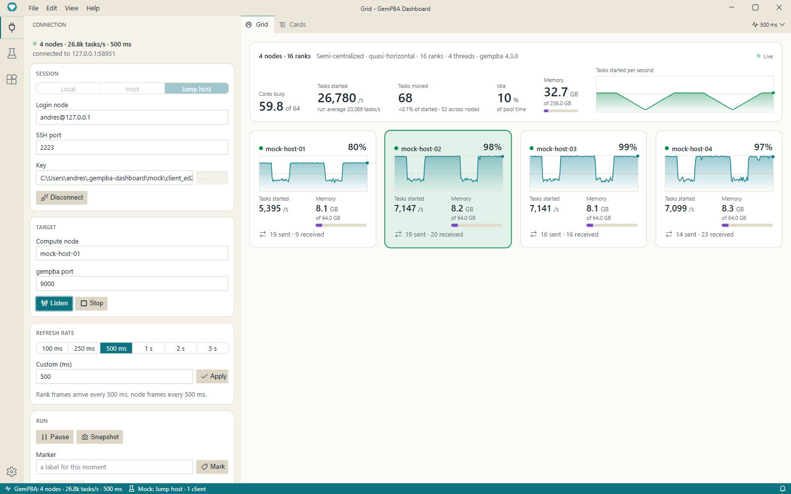
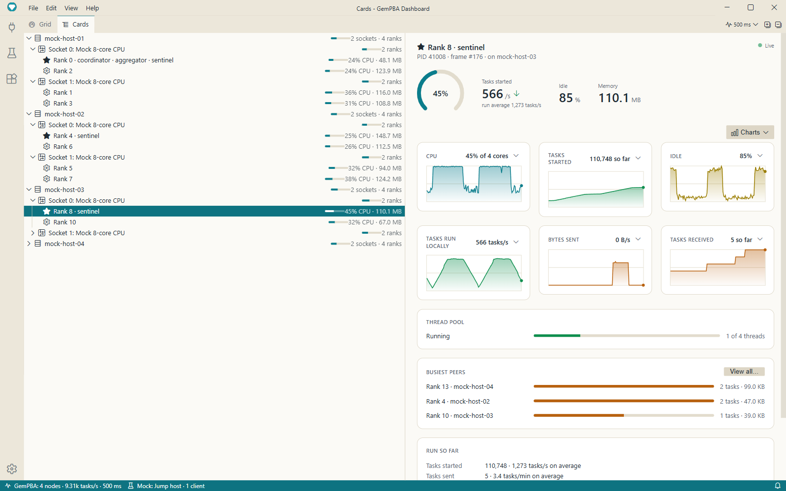
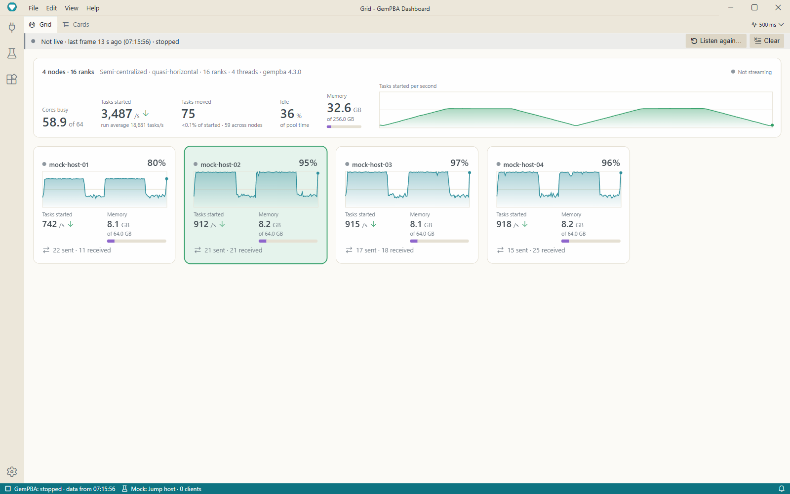
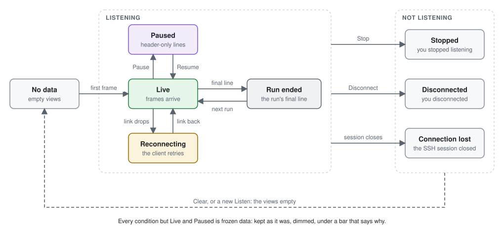
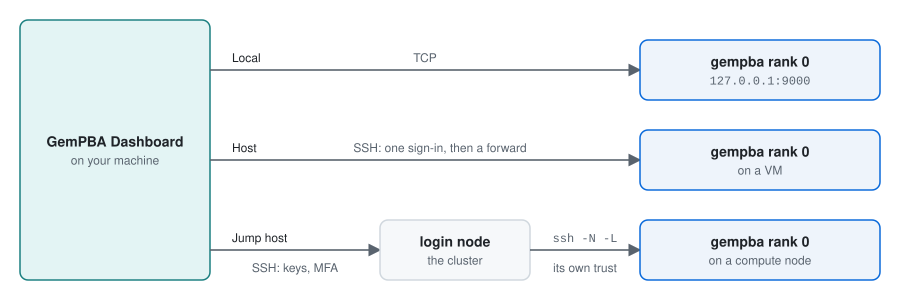
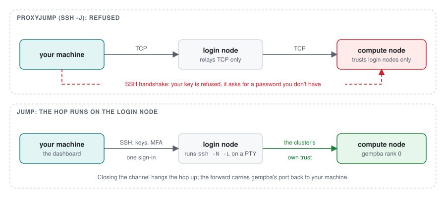
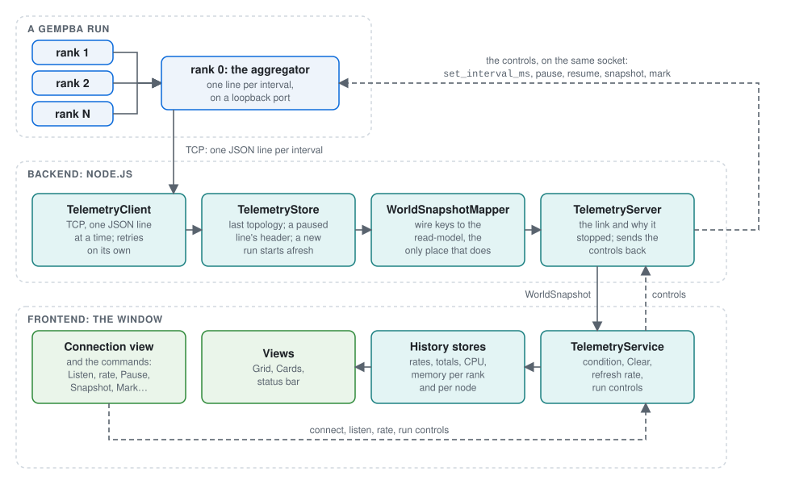

# Dashboard

Let me tell you a storyWhen I was doing my master's, I was building GemPBA and testing it the only way that felt honest: by throwing real branch-and-bound problems at it on a real cluster. That sounds clean. It was not.

Most weeks went one of two ways. Either I was designing the next steps of an algorithm, or I was deep in the library hunting a bug, and the cruel part was that I could rarely tell which one I was actually doing. A run would come back wrong and I would sit there with two suspects and no alibi for either: was my library broken, or was the algorithm I was using to test the library broken? Some days it was one. Some days it was both. Most days I just did not know, and "I do not know" is the most expensive sentence in research.

So I would do what you do. I would write the batch script, set the resources, and submit it to SLURM. And then I would wait. Not minutes. Sometimes days, watching my job sit in the queue behind everyone else's, refreshing the status like it owed me money.

Finally my turn would come. The job would start. Hours would pass. I would go to sleep telling myself that this time the numbers would make sense.

They would not. The run would fail, or it would finish and quietly lie to me. And when I went digging, I would find the thing that still makes my stomach drop to remember: I had fat-fingered a setting, or misused my own library, and out of the hundreds of cores I had reserved, exactly one had done any work. One. A framework whose entire reason to exist is to use all of them, running like a single sad thread, while everything else I had been allocated sat there glowing and idle.

And here is the part nobody warns you about. Those idle cores were not free. They were mine, locked away from every other student and researcher who could have been using them while I was busy being wrong. The scheduler remembers that. Your fair share drops, and the next time you submit you wait even longer. I had paid for nothing, and then I paid for it again.

The worst of it was the blindness. Once a job is running on a cluster, it is a sealed box. You cannot see inside. You cannot tell whether the machine is roaring or asleep. You wait, and you hope, and you find out at the very end whether the last three days of your life meant anything.

So one day I tried to fix the blindness by hand. I spent an entire day, not on my research, on a script: something that would sit on the login node, find every compute node my job had been handed, reach into each one, open `htop`, and throw all of those terminals back onto my screen so I could watch them at once.

It was never a tool you could simply run. I had to be logged into the login node. It was all raw command line, spawning terminal after terminal, and then it was on me to drag them into place, tile them into a wall of little green bars, and sit there reading them like an air traffic controller, trying to judge from across the room whether every node was really working or whether half of them had quietly gone to sleep. It worked, in the way a thing held together with tape works: a full day of effort for a window I had to rebuild and rearrange for every single run, that demanded I keep staring at it, and that went dark the moment I looked away.

I got tired of finding out at the end. And I was done rebuilding that same fragile little window by hand every time I needed to look.

So I built the part I had always been missing: a way to watch the run while it happens.

The GemPBA Dashboard is a desktop app that connects to a running GemPBA program and shows the whole run live: every node and every rank, the cores working, the tasks started and moved each second, where the idle time goes, and the memory. It reads the same [telemetry stream](index.md) the runtime already broadcasts, so any GemPBA program is observable in it with no extra code.

!!! info "Needs gempba v4.3.0 or later"
    Dashboard 2.0 reads telemetry **schema 2**, which gempba v4.3.0 sends. For gempba v4.2.x and earlier, use dashboard 1.x.

<figure markdown="span">
  
  <figcaption>The Grid: the run summed up on top, one tile per node below, here connected through a jump host to four compute nodes.</figcaption>
</figure>

**v2.0.0** · MIT · built on [Eclipse Theia](https://theia-ide.org) and Electron, in the open: every release is compiled by GitHub Actions from the tagged source. Source: [rapastranac/gempba-dashboard](https://github.com/rapastranac/gempba-dashboard).

## What it shows

- **Grid** sums the run up on top: the cores busy, the tasks started each second with their history, the tasks moved between ranks and across nodes, how idle the task-running ranks are, the memory, and how the run is set up (scheduler, load balancer, ranks, threads, gempba version). Below, one tile per node shows its CPU and history, its tasks started, its memory, and the tasks it sent and received. A node whose ranks stop sending fades on its own.
- **Cards** lists the run as a node, socket and rank tree and shows the picked row as a live panel: a rank's CPU on the cores it may use, its tasks, its idle time and where it goes, its memory, its thread pool, its busiest peers, and its totals since the run started. The rank that coordinates the run, the aggregator and each node's sentinel are named as such.
- **Charts** are yours to arrange, three to a row: CPU, memory, idle time, tasks (started, run locally, sent and received) and bytes, each as a rate or a running total. Add, swap, move or remove them, or drag one onto another. Every rank shares one layout and every node another, kept across restarts.

<figure markdown="span">
  
  <figcaption>Cards: the node, socket and rank tree beside a selected rank's live panel and its charts.</figcaption>
</figure>

**Data that stops still makes sense.** When a run pauses, ends, or the connection drops, the views keep what they last showed, fully usable and dimmed a little, under a bar that says why and since when: `Paused`, `Run ended`, `Reconnecting…`, or `Not live` with its cause. Nothing clears until you press **Clear** or listen again.

<figure markdown="span">
  
  <figcaption>Stop listening and the views hold their last state, dimmed, under a bar that says why and since when.</figcaption>
</figure>

<figure markdown="span">
  
  <figcaption>What the stream can be doing, and what each state keeps on screen.</figcaption>
</figure>

## Download and install

Get the installer for your platform from the [latest release](https://github.com/rapastranac/gempba-dashboard/releases/latest).

[Download for Windows, macOS, or Linux](https://github.com/rapastranac/gempba-dashboard/releases/latest){ .md-button .md-button--primary }

| Platform | Asset | Install |
|---|---|---|
| Windows (x64) | `gempba-dashboard-<version>-win-x64.exe` | Run the installer; it installs for your user and lets you pick the folder. |
| macOS (Apple Silicon) | `gempba-dashboard-<version>-mac-arm64.dmg` | Open the dmg and drag the app to Applications. A `.zip` of the app is there too. |
| macOS (Intel) | `gempba-dashboard-<version>-mac-x64.dmg` | Same as above. |
| Linux (x64) | `gempba-dashboard-<version>-linux-x86_64.AppImage` | `chmod +x` and run it; it needs FUSE 2 (`sudo apt install libfuse2t64` on Ubuntu 24.04). |
| Debian/Ubuntu (x64) | `gempba-dashboard-<version>-linux-amd64.deb` | `sudo apt install ./gempba-dashboard-<version>-linux-amd64.deb` |

!!! note "First launch on Windows and macOS"
    The builds are not code-signed yet, so the OS warns the first time. On Windows, click **More info** then **Run anyway** on the SmartScreen prompt. On macOS, open **System Settings → Privacy & Security** and click **Open Anyway**, or clear the quarantine flag: `xattr -dr com.apple.quarantine "/Applications/GemPBA Dashboard.app"`. Linux has no prompt.

Prefer to build it yourself? With Node.js 22: `npm ci && npm run build && npm start` (the repo's README lists the per-OS build packages).

## Connect

gempba serves its telemetry on a loopback port on whatever machine rank 0 runs on. The dashboard reaches that port one of three ways, chosen in the **Connection** view:

<figure markdown="span">
  
  <figcaption>Local, Host, or Jump host: the same stream, reached three ways.</figcaption>
</figure>

- **Local**: gempba runs on this machine; just **Listen** on its port. No session needed.
- **Host**: gempba runs on a VM or box you reach over SSH (`user@host[:port]`).
- **Jump host**: gempba runs on a compute node behind a login node, as on an HPC cluster. The dashboard signs in to the login node, which reaches the compute node with the cluster's own SSH trust.

SSH uses your keys and `known_hosts` in `~/.ssh`, asks to trust a new host once, and prompts for passphrases and MFA codes in a dialog. If the session drops, the dashboard says so and lets you connect again.

Jump-host mode nests the hop rather than using SSH `ProxyJump`, so it works even when only the login node is reachable and it enforces MFA:

<figure markdown="span">
  
  <figcaption>Why jump-host mode nests the hop instead of using <code>ProxyJump</code>.</figcaption>
</figure>

<!-- HD walkthrough videos go here when recorded. For each one, drop a YouTube id into a block like:
<figure>
  
<iframe src="https://www.youtube.com/embed/VIDEO_ID?si=SI" title="GemPBA Dashboard: connecting to a local run" allow="accelerometer; autoplay; clipboard-write; encrypted-media; gyroscope; picture-in-picture; web-share" referrerpolicy="strict-origin-when-cross-origin" allowfullscreen></iframe>

  <figcaption>Connecting to a local run.</figcaption>
</figure>
-->

The gempba port must match the one the run bound (see [Configuration](configuration.md#the-dashboard-port)). To find which host runs rank 0, see [Connecting](connecting.md).

## Using it

- **Connection** (the plug icon) holds four panels: **Session** (Local, Host or Jump host, and for SSH the host, port and key), **Target** (the compute node and gempba's port, then **Listen**), **Refresh rate** (a preset or your own, in milliseconds), and **Run** (**Pause**/**Resume**, **Snapshot**, a labelled **Mark**, and **Clear data**).
- **Grid**: click a tile to select its node; double-click, or press Enter, to open it in Cards. **Cards**: pick a row for its panel, and shape the layout from the **Charts** button and each chart's menu.
- **The status bar** sums the stream up, such as `4 nodes · 26.6k tasks/s · 500 ms`, and clicking it exposes the live controls. Every command is also in the palette (F1) as `GemPBA: …`, and **Settings** (the gear) lists GemPBA's options, including the built-in GemPBA Light and Dark themes.

**Change the cadence without touching the run.** One refresh rate drives every frame, and the dashboard pushes it to the running job over the open connection. gempba is compiled into your application, so a job already on a cluster is a fixed binary, yet you can dial detail up while you watch and back down when you step away, with no recompile, restart, or resubmit. This is the client side of the runtime's [live cadence control](configuration.md#emission-cadence-and-live-control).

## The data path

Each feature is an [Eclipse Theia](https://theia-ide.org) extension plugged into one telemetry hub. A rank's frames reach rank 0, which sends one line per interval; the dashboard maps each line to a snapshot for the window, where the hub keeps the histories the views draw, and the controls travel back the same way.

<figure markdown="span">
  
  <figcaption>From a rank's frame to the chart on screen, and controls back the other way.</figcaption>
</figure>

The repo's [ARCHITECTURE.md](https://github.com/rapastranac/gempba-dashboard/blob/main/ARCHITECTURE.md) walks through the packages and the extension model, and [DeepWiki](https://deepwiki.com/rapastranac/gempba-dashboard) is an AI-assisted tour of the source.

## Headless or scripted?

If you want the stream without a GUI (a terminal tail, a log, a custom consumer), the bundled `telemetry_view` script and the raw JSON protocol are documented under [Connecting](connecting.md) and [Data model](data-model.md).

## Source and license

[rapastranac/gempba-dashboard](https://github.com/rapastranac/gempba-dashboard), MIT, built on Eclipse Theia and Electron. Issues and contributions are welcome there. Every published installer is built by GitHub Actions from the tagged source.
