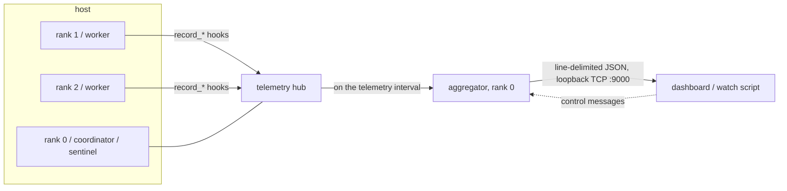

# Telemetry

GemPBA ships with a built-in **runtime telemetry** system. While your search runs, every rank publishes a live stream of what it is doing: tasks started, sent, received, and running; where its thread-pool idle time went; scheduler backlog and timing; per-process CPU and memory; and a rank-to-rank traffic list, alongside per-host CPU and memory and the full hardware topology. It is **on by default**, in every flavor (`mt` and `mp-mpi`), so your production runs are observable out of the box with nothing to wire up.

!!! info "Built in, on by default"
    Telemetry is compiled into the library, so there is no build flag to enable it; it starts automatically when the runtime comes up. Opt out at runtime with `gempba::telemetry::disable()` (see [Configuration](configuration.md)). Hardware-topology fields are populated when GemPBA is built with hwloc (`GEMPBA_HWLOC`, on for releases); without it, core/socket counts read as 0 and everything else still works.

## Why it's in the box

Live, per-rank observability across a distributed run is normally a project of its own: a metrics sidecar to deploy, a transport that won't perturb the workload, a schema everyone has to agree on, and some way to reach processes scattered across nodes. GemPBA handles that part. Telemetry rides its **own private MPI communicator** (`MPI_Comm_dup`), so it never collides with application traffic; it aggregates every rank into a single stream; and it exposes that stream on a channel a client can not only read but **steer**. Emission cadence is retunable live, mid-run, without restarting the job (see [Configuration](configuration.md#emission-cadence-and-live-control)).

## One implementation, every binding

Telemetry lives in the C++ runtime, beneath the public API, not in any one front-end. So every binding inherits it for free: the [Java binding](../java/index.md) is fully observable today with no telemetry-specific code, and anything else built on the [stable C ABI](../java/how-it-works.md) would consume the same stream the same way. There is no per-language telemetry to write or keep in sync; there is one implementation, in the core.

## What it gives you

- **Per-rank frames**: cumulative task counters (started / sent / received), tasks currently running, scheduler pending count, pool idle time split into starved and imbalanced, scheduler running and waiting time, the bytes and time spent moving tasks, process CPU %, RSS, thread count, and a per-destination **traffic list** (`edges_out`) for visualizing how work flows between ranks.
- **Per-host frames**, emitted by one **sentinel** rank per host: per-socket CPU and memory, total/available memory, and the job's own memory usage and limit (from its enforcing cgroup, so a shared node shows gempba's allocation rather than the whole machine).
- **Topology snapshot**, captured once at startup: every host, the ranks it owns, each rank's scheduler role, per-socket physical/logical core counts, CPU names, and CPU-id lists, plus a `run` object with the run's setup, annotations and markers. Frames carry numeric `rank`s; the topology maps them back to host and hardware.
- **Live control**: a connected client can retune the one telemetry interval, and pause, resume, snapshot or mark the run, on the fly, so a dashboard can dial detail up while you watch and back down for long unattended runs.

## How it fits together

- **The hub** (`gempba::telemetry::telemetry_hub`): one per process. Ranks feed it through lock-free `record_*` hot-path hooks; it snapshots the counters into frames on the telemetry interval and pushes them over the transport.
- **Transports**, chosen by runtime mode: an in-process **local** transport for `mt`, and an **MPI** transport on a *private* communicator (`MPI_Comm_dup`, so telemetry never collides with application traffic) for `mp-mpi`, auto-installed inside `create_scheduler` on every rank.
- **The aggregator**: rank 0 aggregates every rank's frames and runs a **loopback-only TCP server** (default `127.0.0.1:9000`) that broadcasts the merged stream as line-delimited JSON to any number of connected clients. That socket is the dashboard channel.

## Where to go next

- **[Configuration](configuration.md)**: the runtime kill switch (C++ and Java), the TCP port, and emission cadence and live control.
- **[Connecting](connecting.md)**: live-tail a local run with the bundled `telemetry_view`, or reach a remote run with the dashboard.
- **[Data model](data-model.md)**: the JSON broadcast a consumer reads, linking the full gempba wire-format reference.
- **[Dashboard](dashboard.md)**: the GemPBA Dashboard desktop app, a live cluster grid and per-node detail for any run, with built-in SSH for remote and jump-host connections.
